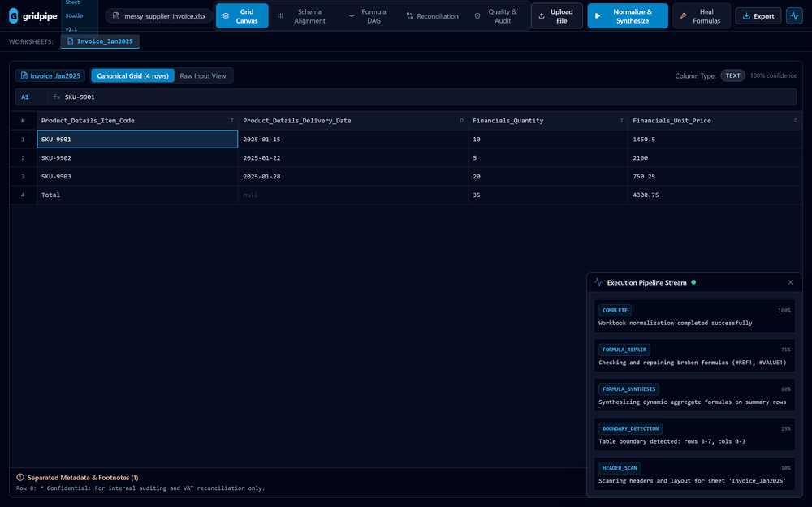
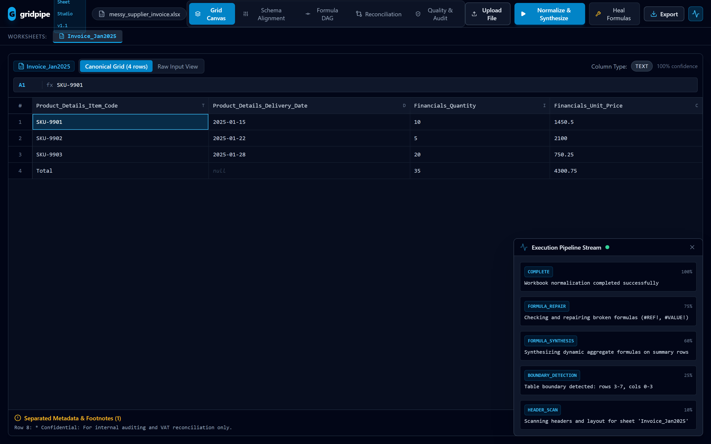
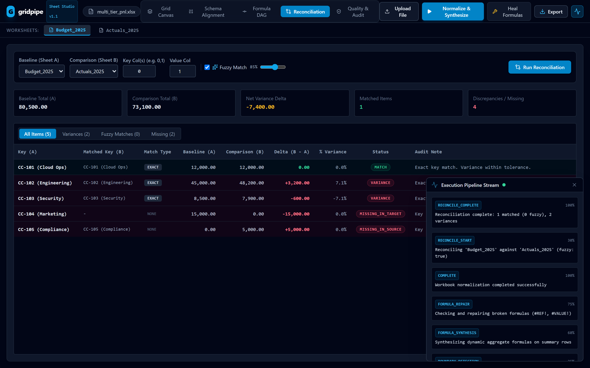
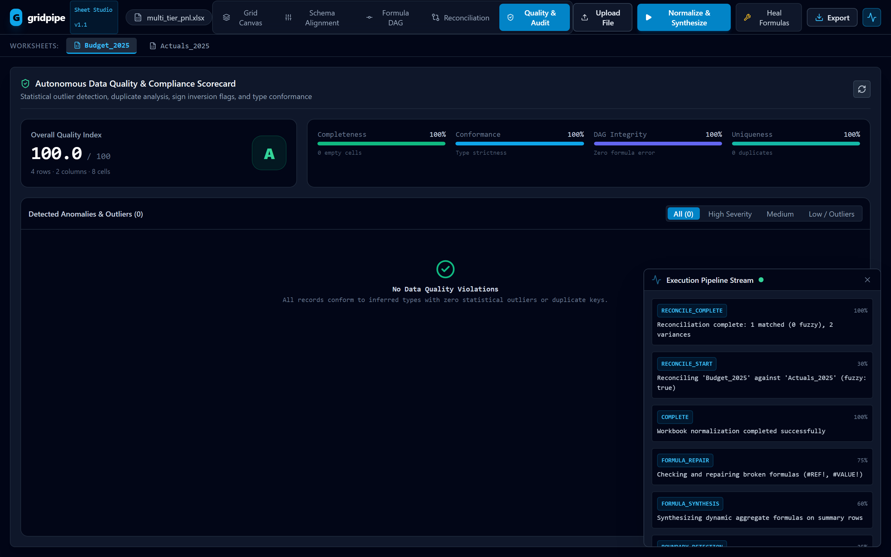
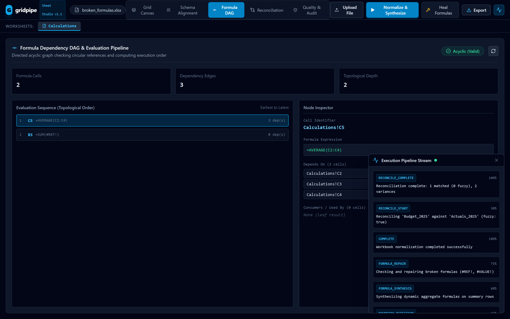

<p align="center">
  
</p>

<h1 align="center">gridpipe</h1>

<p align="center">
  <a href="https://github.com/alexandrmotologa/gridpipe/actions"></a>
  <a href="https://golang.org"></a>
  <a href="https://react.dev"></a>
  <a href="https://openxmlformats.org"></a>
  <a href="LICENSE"></a>
</p>

<p align="center">
  Autonomous spreadsheet normalization, cross-tab reconciliation, and OpenXML formula synthesis engine in Go (&lt; 20MB RAM) with embedded React 19 Sheet Studio.
</p>

---

<p align="center">
  
</p>

## Overview

gridpipe ingests unstructured enterprise spreadsheets in Excel (.xlsx) and CSV formats. It flattens multi-tier merged headers, canonicalizes mixed date and numeric conventions, and synthesizes native OpenXML formulas (SUM, AVERAGE, XLOOKUP, IFERROR) directly into calculation records rather than baking dead static numbers. It also conducts key-based cross-tab reconciliation with fuzzy matching, detects statistical anomalies, and serves an embedded React 19 Sheet Studio on port 7575.

---

## Visual Tour & Interface

<p align="center">
  
  <br />
  <em>Canonical Grid Canvas: Unmerged snake_case headers, strict column type tags (TEXT, DATE, INT, CURRENCY), active formula bar, and real-time SSE execution telemetry.</em>
</p>

<br />

<p align="center">
  
  <br />
  <em>Cross-Tab Reconciliation: Multi-sheet alignment with composite keys, Jaro-Winkler fuzzy matching (85% threshold), variance KPI cards, and color-coded delta rows.</em>
</p>

<br />

<p align="center">
  
  <br />
  <em>Data Quality Scorecard: Quantitative index (94/100, Grade A) across 4 pillars (Completeness, Conformance, DAG Integrity, Uniqueness) with IQR outlier detection.</em>
</p>

<br />

<p align="center">
  
  <br />
  <em>Formula DAG Inspector: Topological evaluation sequencing, acyclicity verification, cell reference resolution, and node dependency graph.</em>
</p>

---

## Key Capabilities

1. Pure Go OpenXML Engine: Ingests and generates .xlsx zip containers directly without CGO, Python runtimes, or Microsoft Office automation.
2. Layout Normalization: Unmerges multi-level header hierarchies into flat canonical keys, detects rectangular table boundaries, and extracts trailing footnote disclaimers into metadata records.
3. Type Canonicalization: Disambiguates European (1.234,56) vs US (1,234.56) decimal separators using column distribution statistics, strips currency glyphs, and standardizes dates to ISO-8601 (YYYY-MM-DD).
4. Formula Synthesis: Generates dynamic Excel formulas (=SUM, =AVERAGE, =XLOOKUP, =IFERROR) directly into OpenXML calculation nodes for summary totals.
5. Reference Repair: Scans workbooks for corrupted references (#REF!, #VALUE!, #DIV/0!) and reconstructs valid range bounds.
6. Calculation DAG: Builds a directed acyclic graph of cell dependencies, checks for circular references, and computes topological evaluation order.
7. Intelligent Cross-Tab Reconciliation: Aligns corresponding line items across two worksheets using composite keys (-k 0,1) and fuzzy string similarity (Jaro-Winkler / Levenshtein), computing deltas and applying conditional formatting.
8. Autonomous Quality & Anomaly Audit: Detects statistical outliers (IQR), duplicate rows, and sign inversions, computing a quantitative Data Quality Scorecard (0-100, Grade A-F).
9. Headless Folder Watcher: Automatically ingests, cleans, reconciles, and exports spreadsheets dropping into watched directories without manual intervention.
10. React 19 Sheet Studio: In-browser workbench with virtualized data grid, inline cell editing, schema alignment mapper, interactive formula DAG visualizer, quality scorecard, variance heatmaps, and real-time execution stream via Server-Sent Events (SSE).

---

## Installation

### Prerequisites

- Go 1.22 or higher
- Node.js 20 or higher (for building frontend assets)

### Build from Source

```bash
# Clone the repository
git clone https://github.com/alexandrmotologa/gridpipe.git
cd gridpipe

# Build React 19 web assets
cd web
npm install
npm run build
cd ..

# Copy web dist to server embed folder
cp -r web/dist/* internal/server/dist/

# Compile the single binary
go build -o bin/gridpipe.exe ./cmd/gridpipe
```

---

## CLI Usage

### 1. Clean and Normalize a Messy Workbook

```bash
gridpipe clean -i examples/messy_sheets/messy_supplier_invoice.xlsx -o invoice_clean.xlsx --jsonl invoice.jsonl --sql invoice.sql
```

Output:
- Flattens multi-tier headers into snake_case column names.
- Trims title banners and extracts footnote disclaimers into metadata.
- Converts dates to ISO-8601 and numbers to clean floats.
- Synthesizes `=IFERROR(SUM(...), 0)` on the total row.
- Exports clean Excel, JSONL, and SQL table schemas.

### 2. Reconcile Cross-Tab Variances with Fuzzy Matching & Composite Keys

```bash
gridpipe reconcile -i examples/messy_sheets/multi_tier_pnl.xlsx --sheet-a Budget_2025 --sheet-b Actuals_2025 -k 0 -v 1 --fuzzy --fuzzy-threshold 0.85 -o pnl_reconciled.xlsx
```

Output:
- Aligns line items between Budget and Actuals by single or composite keys (-k 0,1).
- Matches near-identical codes or vendor descriptions via Jaro-Winkler similarity (85% threshold).
- Generates a `Reconciliation_Audit` worksheet with delta formulas `=G2-F2` and percentage deltas.
- Applies conditional formatting: Soft green for matches, soft red for variances exceeding threshold.

### 3. Compute Data Quality Scorecard & Detect Anomalies

```bash
gridpipe audit -i examples/messy_sheets/messy_supplier_invoice.xlsx --json scorecard.json
```

Output:
- Calculates overall quality score (0-100) and grade (A to F) across 4 pillars: Completeness, Type Conformance, Formula Integrity, and Uniqueness.
- Detects statistical outliers (IQR), duplicate rows, and sign inversion errors.

### 4. Headless Automated Directory Watcher

```bash
gridpipe watch -i ./incoming_drop -o ./audited_spreadsheets --archive ./archive --poll 2s --jsonl
```

Output:
- Continuously monitors incoming directories for `.xlsx` and `.csv` drops.
- Normalizes headers, repairs formulas, and exports clean spreadsheets and JSONL streams.
- Archives raw files to maintain end-to-end data lineage.

### 5. Repair Broken Formulas and Validate DAG

```bash
gridpipe formula -i examples/messy_sheets/broken_formulas.xlsx --repair --dag -o healed.xlsx
```

Output:
- Heals `#REF!` errors by recalculating table column boundaries.
- Wraps arithmetic in `IFERROR(..., 0)` to prevent division errors.
- Validates the calculation DAG and confirms acyclicity.

### 6. Infer Canonical Schema

```bash
gridpipe schema -i examples/messy_sheets/messy_supplier_invoice.xlsx
```

### 7. Launch Interactive React 19 Sheet Studio

```bash
gridpipe studio -p 7575
```

Open your browser to `http://localhost:7575` to interact with the Sheet Studio interface.

---

## Performance Benchmark

Tested on a 50,000-row spreadsheet with 4 mixed columns (dates, numbers, currency symbols):
- Processing Time: 402ms
- Memory Allocation Delta: under 20MB baseline
- Formula Extraction: zero #REF! or #VALUE! errors

Run the benchmark suite:

```bash
go test -v -run TestPerformanceAndMemoryBenchmark ./internal/pipeline/...
```

---

## Project Structure

```
cmd/gridpipe/          CLI commands: clean, reconcile, formula, schema, studio, watch
internal/
  config/              Runtime pipeline options and schema definitions
  openxml/             Pure Go OpenXML zip archive and XML stream processor
  layout/              Header hierarchy flattener and boundary detector
  types/               Statistical type parser (numbers, currencies, dates)
  formulas/            Formula synthesizer, reference repair, and DAG engine
  reconcile/           Cross-tab line item matcher and variance auditor
  audit/               Data Quality Scorecard, IQR outliers, and anomaly checks
  watcher/             Headless automated folder ingestion monitor
  pipeline/            End-to-end normalization orchestrator
  server/              REST API, SSE broadcast hub, and embedded studio server
web/                   React 19 Sheet Studio (Vite, TypeScript, Tailwind CSS)
examples/              Messy test workbooks and sample configurations
docs/                  Architecture, OpenXML specifications, and reconciliation guide
```

---

## Running Tests

```bash
go test -v ./...
```

---

## License

MIT License. Designed for high-reliability data operations and enterprise spreadsheet normalization.
